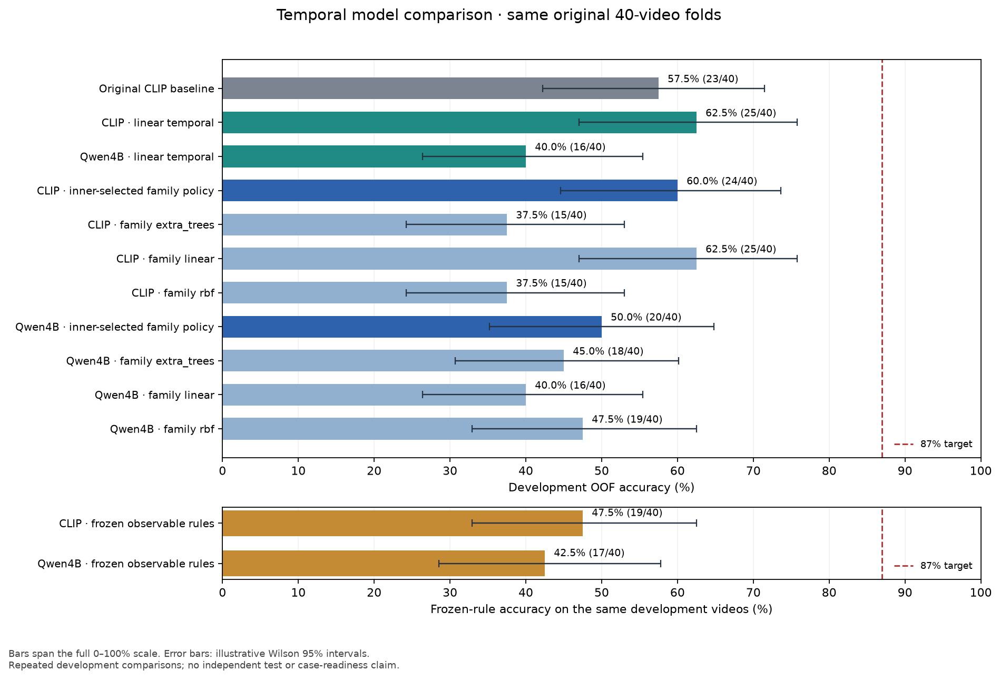

# Datathon: cashier procedure detection

Model experiments for detecting possible cashier procedure violations in video. All inference runs in Python with downloaded pretrained weights; no hosted LLM API is used. Work currently focuses on models and evaluation.

## CatBoost and preprocessing follow-up: 18 October 2026

The completed gradient-boosted tree comparison did **not** improve the best model. The policy selecting its feature arm, tree settings and threshold inside training folds scored **55.0% accuracy**, **54.64% balanced accuracy**, 61.90% violation recall and 47.37% specificity. It missed 8/21 violations and raised 10 false alarms among 19 normal recordings. The existing **62.5% temporal model remains the development reference; 87% remains unmet**.

| Predefined CatBoost feature arm | Accuracy | Balanced accuracy |
|---|---:|---:|
| Semantic temporal summaries | 45.0% | 45.36% |
| CLIP summaries from all four views | 57.5% | 57.52% |
| All-view CLIP with 16-component PCA | 50.0% | 48.37% |
| Full-frame CLIP summaries only | 42.5% | 43.48% |

Each arm uses three fixed shallow-tree settings, 160 iterations and a 0.03 learning rate. The same original 40 source-SHA outer folds are retained; three inner grouped folds select settings and thresholds. PCA fits training recordings only. The separately reported arm scores are development comparisons, not a new test set or a replacement for the primary selection policy. The PCA arm's 80.95% recall came with only 15.79% specificity, so its 16 false alarms do not represent a useful improvement. These heads classify whole recordings and provide no violation timestamps.

The preprocessing audit found that all 22 supplied event points align exactly with cached samples; typical sample spacing is 0.5 seconds, with a maximum gap of 0.5333 seconds. A separate training-only window PCA audit retained 61.89–64.36% of variance in 32 components. Explained variance does not establish how much violation information survives compression. These checks found no event-point alignment failure; they do not certify image detail or annotation correctness. At this benchmark snapshot, **145 regression tests passed locally and in Colab**.

Pretrained models were already central to the earlier DINOv2, CLIP, X3D and local Qwen comparisons. A stronger tree learner still needs useful visual features and reliable labels. Public-data research found auxiliary action datasets, including [CAP](https://visym.github.io/cap/) and [NTU120](https://rose1.ntu.edu.sg/dataset/actionRecognition/), but no verified banking-compliance labels suitable for direct binary augmentation. No external raw videos were added; see the [source and license audit](reference/public_video_data_research.json).

The separate X3D-S transfer comparison retained all 400 Kinetics action scores, including pretrained cash-counting actions, and fitted the same three fixed CatBoost settings. It scored **42.5% accuracy**, **43.73% balanced accuracy**, 19.05% violation recall and 68.42% specificity (17 misses, 6 false alarms). It supplies no timestamps and is not selected. All five tree artifacts and the X3D artifact were fitted and exported; fresh-process feature-only prediction passed offline. Training and prediction guards observed zero Python network attempts. These feature-cache prediction checks are not uncached video-latency measurements.

Run the [boosted-model notebook](datathon_boosted.ipynb) and inspect the [measured summary](artifacts/boosted_experiment_summary.json), [table](artifacts/boosted_model_comparison.csv), [chart](artifacts/boosted_model_comparison.png) and [preprocessing audit](artifacts/preprocessing_audit.json). Historical experiment snapshots follow below.

## Custom recordings: 18 October 2026

Prepared all **39 new camera views** as silent H.264 derivatives at a maximum 1280-pixel long edge and 15 fps. Originals remain untouched. Storage fell from 637.45 MB to 108.96 MB (**82.91% smaller**); maximum duration drift is 0.033 seconds. Numeric quality checks on 117 aligned samples average SSIM 0.977 at the prepared resolution; this does not certify every small detail lost by downsampling.

The supplied custom workbook's first three columns copy the original 42 labels and match **none** of the new filenames. Its two added columns contain 84 unverified notes about the original 40 sources. They do not label the new footage. The iPhone and Samsung views show the same simultaneously filmed scenes with unresolved pairings, so all custom views stay in one conservative filming group.

The [custom-data Colab notebook](datathon_custom.ipynb) completed visual-only annotation and model comparisons. All 39 views remained unresolved, so no generated labels entered supervised training. The local review workbook leaves their labels and timestamps blank. The temporal model reproduced **62.5% accuracy**; the limited point policy scored 50% and matched 6/22 supplied event points within five seconds.

Adding the 39 unlabeled views to uniform scaler/PCA fitting reduced accuracy from **57.5% to 42.5%** against its matched original-only policy. Both arms use the same original 40 held-out SHA folds; custom labels never become validation, calibration or test targets. This adaptation is not retained as an improvement. The experiment using training-owned, unverified notes failed because an inner training fold lacked usable prototypes for both classes; it produced no valid accuracy score or fitted head. At this historical custom-data milestone, **136 regression tests passed locally and in Colab**.

See the [custom experiment summary](artifacts/custom_experiment_summary.json), [comparison table](artifacts/custom_model_comparison.csv), [comparison chart](artifacts/custom_model_comparison.png), [dataset audit](artifacts/custom_dataset_audit.json) and [compression measurements](artifacts/custom_compression_quality.json). Local preparation and inference commands are in [the detailed notes](README_ML.md).

## Measured progress

The best development accuracy is **62.5% (25/40)**, improved from **57.5% (23/40)**. The **87% target remains unmet**. These repeated comparisons use the same 40 unique recordings and are not an independent test.

| Approach | Accuracy | Violation recall | Specificity |
|---|---:|---:|---:|
| Original CLIP embedding baseline | 57.5% | 33.3% | 84.2% |
| CLIP observable states + linear temporal head | **62.5%** | **52.4%** | **73.7%** |
| CLIP states + inner-selected linear/SVM/tree head | 60.0% | 42.9% | 78.9% |
| Local Qwen4B states + linear temporal head | 40.0% | 57.1% | 21.1% |
| Local Qwen4B states + inner-selected head | 50.0% | 71.4% | 26.3% |

The best classifier misses 10/21 positive recordings and does not localize any supplied event point within five seconds. It is not ready for case submission. Event types and full intervals still need human verification.

Earlier temporal-model milestones:

- Audited 42 label rows into 40 unique recordings, preserving duplicate groups and 22 supplied event points.
- Compared frozen appearance, motion and multimodal representations, followed by 18 observable states, temporal rules and small learned heads.
- Reused the original outer folds; preprocessing, calibration and head selection fit only inside training folds.
- Passed 82 regression tests locally and in Colab. Fresh CLIP inference on the longest supplied recording took 31.3 seconds on a Colab T4, with zero Python network attempts under a blocking guard. This measures execution, not new-video accuracy.

The strongest next step is to verify simple **violation + timestamp** labels, identify paired scenes, and train a point-guided temporal classifier with related views grouped together. Use balanced accuracy alongside violation recall, specificity and timestamp recall. Reserve a new filming session and unseen scenes for acceptance; another view of a training scene is not an independent test.

## Start here

- [Full case analysis, methods, limitations and commands](README_ML.md)
- [Self-contained Colab notebook: CatBoost and PCA comparisons](datathon_boosted.ipynb)
- [Measured boosted-model comparison](artifacts/boosted_experiment_summary.json)
- [Public video data source and license audit](reference/public_video_data_research.json)
- [Self-contained Colab notebook: custom-data comparisons](datathon_custom.ipynb)
- [Measured custom-data comparison](artifacts/custom_experiment_summary.json)
- [Self-contained Colab notebook: best measured CLIP temporal path](datathon_temporal.ipynb)
- [Earlier embedding baseline notebook](datathon.ipynb)
- [Measured temporal comparison](artifacts/temporal_experiment_summary.json)
- [Annotation review queue](artifacts/annotation_review_v2.csv)
- [Original baseline fold reference](reference/clip_baseline_cv.json)
- [Case requirements](case_requirement.txt)



## Reproduce and run inference

Use a GPU runtime in Colab and open `datathon_temporal.ipynb`. Its embedded source snapshot is checksummed and contains no recordings or model weights. The default runs the CLIP linear temporal experiment; slower Qwen and nonlinear-head comparisons are optional. Supply the organizer data separately or use the organizer download cell. All model execution stays in that runtime.

For a local Python environment, install dependencies and supply the dataset path:

```bash
python -m pip install -r requirements-ml.txt -r requirements-experiments.txt -r requirements-vlm.txt
python -m unittest discover -s tests -v
python tools/run_temporal_colab.py --workspace . --data-root /path/to/open --skip-qwen --skip-heads
```

The driver creates fitted heads and numeric caches locally. To analyze an unlabeled video using a trusted fitted CLIP head:

```bash
python semantic_predict_experiment.py --video /path/to/video.mov --model /path/to/model_temporal.joblib --output-dir artifacts/new_prediction
```

Inference is offline by default. Download the original encoder checkpoint during setup, or explicitly use `--allow-download` for that step. Keep the exact matching source with each trained head: source fingerprints reject changed bytes, including changed line endings. `.gitattributes` preserves committed bytes across platforms.

Regenerate the temporal notebook after source changes:

```bash
python tools/build_temporal_notebook.py --baseline-cv reference/clip_baseline_cv.json --measured-summary artifacts/temporal_experiment_summary.json
```

## Repository contents

Git tracks source, tests, clean notebooks, requirements, case documentation, original fold assignments and compact measured reports. Recordings, organizer workbooks, downloaded checkpoints, fitted heads, feature/state caches, executed notebook outputs and export archives remain local and are excluded by `.gitignore`. Some paths in historical reports refer to the original experiment workspace; use the tracked reference report to reproduce its folds.

The initial Git snapshot records the completed 17-18 October 2026 experiments. Subsequent model changes should include their measured results and limitations in the same commit so progress stays reviewable.
